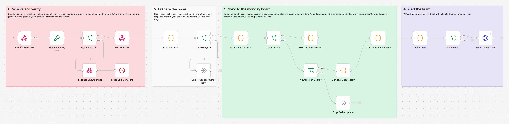
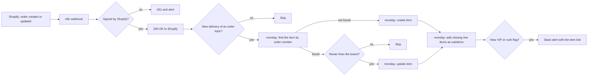

# Shopify Orders to Monday.com Fulfillment Board

Every Shopify order becomes one item on a monday.com fulfillment board, with its line items as subitems. The item stays in sync as the order is paid, fulfilled or cancelled, and VIP or rush orders ping the team in Slack. Built with n8n.



## The problem

Many fulfillment teams work from a monday.com board, but the orders come from Shopify. Someone copies them over by hand, or a simple connector creates a new item every time the order changes. The board fills up with duplicates, the payment and fulfillment status on it goes stale, and a big order or an overnight shipment sits in the queue like any other.

## What this does

1. **Adds every new order to the board within seconds.** One item per order with the order number, customer, email, total, payment status, fulfillment status, shipping method and order date, plus one subitem per line item with its SKU and quantity.
2. **Keeps that item up to date.** When the order is paid, fulfilled, refunded, cancelled or edited in Shopify, the same item changes. It never creates a second one.
3. **Ignores repeat deliveries.** Shopify resends a webhook when it is not sure it arrived. Each delivery is processed once.
4. **Ignores updates that arrive late.** Shopify does not promise to deliver webhooks in order. An update older than what the board already shows is skipped, so a fulfilled order never flips back to unfulfilled.
5. **Flags VIP and rush orders.** VIP when the total is at or above your limit, rush when the shipping method matches your keywords (express, overnight and so on). Each flag posts one Slack alert with a link to the item.
6. **Rejects anything Shopify did not sign.** Forged or changed webhooks get a 401 and raise an alert. If the secret is missing from n8n, every webhook is refused the same way, with an alert that says so.
7. **Fails loudly.** A monday error, including the ones monday returns with HTTP 200, stops the run with the order number and the reason, and the error workflow posts it to Slack. If a run stops partway, the next update of that order fills in what is missing. Rate limits and a locked board wait as long as monday asks, up to a minute per try.

## How it works



The webhook answers Shopify as soon as the signature checks out, before any monday call. Shopify only waits five seconds and resends anything slower, so a slow moment at monday never turns into extra deliveries.

Both order topics run through the same steps. An update for an order that is not on the board yet (for example one placed before you switched the workflow on) creates it, and a late `orders/create` for an order that is already there just updates it.

### Why the monday calls run in Code nodes

monday's GraphQL API answers most errors with HTTP 200 and an `errors` array, and its rate limit errors include `retry_in_seconds`, which can be up to a minute. n8n's HTTP Request node treats any 200 as a success and caps its retry wait at 5 seconds. So each "Monday:" node carries the same small GraphQL client: it sends GraphQL variables (no string building), fails the step on any GraphQL error, waits as long as monday asks on a rate limit or a locked board (423), retries timeouts and server errors, and stops after `MONDAY_MAX_ATTEMPTS`. After about 4 minutes in one step, it stops retrying and Add Line Items stops starting new lines, so the step ends with a clear message before n8n's 5 minute Code node limit cuts it off.

### How duplicates are prevented

Three layers, each covering a different case:

1. **Delivery ID.** Every `X-Shopify-Webhook-Id` is remembered for 48 hours, so Shopify's retries are skipped before any monday call.
2. **Search before create.** The order number is looked up with `items_page_by_column_values` (exact match only). Found means update.
3. **Idempotency key on every create.** For a new order, Shopify often sends `orders/create` and `orders/updated` within a second of each other, and both runs can miss the item in the search. Both then call `create_item` with the same `Idempotency-Key`, so monday creates the item once and hands the second run the same item. That run applies its own values only if they are newer. Subitems use one key per line item, so a retry after a lost response never adds a line twice.

## Workflow at a glance

| Step | Nodes | What it does |
|---|---|---|
| 1 | Shopify Webhook | Receives `orders/create` and `orders/updated` (POST, raw body kept for the signature check) |
| 2 | Sign Raw Body, Signature Valid?, Respond: Unauthorized, Stop: Bad Signature | Recomputes the base64 HMAC SHA256 of the raw body with your secret. A missing or wrong `X-Shopify-Hmac-Sha256` gets a 401 and an alert. With no secret set, every webhook is refused |
| 3 | Respond: OK | Answers Shopify with 200 straight away |
| 4 | Prepare Order, Should Sync?, Skip: Repeat or Other Topic | Checks the config, skips repeat deliveries and other topics, maps the order to your columns and sets the VIP and rush flags. Shipping lines removed by an order edit are left out, and line items use their current quantity |
| 5 | Monday: Find Order | Finds the item by order number and reads its flags, last Shopify update time and subitems |
| 6 | New Order?, Monday: Create Item | `create_item` with every mapped column and an idempotency key per order |
| 7 | Newer Than Board?, Monday: Update Item, Skip: Older Update | `change_multiple_column_values` when the update is newer than the board, and works out which line items are still missing |
| 8 | Monday: Add Line Items | `create_subitem` for each missing line item (name, SKU, quantity), each with its own idempotency key |
| 9 | Build Alert, Alert Needed?, Slack: Order Alert | Posts new VIP and rush flags, and a cleanup note if the board already had duplicate items for the order. Text from the order is escaped, so Slack shows it as plain text |

## The board

Create these columns on your board (any titles, any order). Only the order number is required; leave a key out of `MONDAY_COLUMNS` to skip that column.

| Key in `MONDAY_COLUMNS` | Suggested title | Column type | What goes in |
|---|---|---|---|
| `order_number` | Order | Text | `#1001`, used to find the item again |
| `customer` | Customer | Text | Customer name, or the billing name for guest checkouts |
| `email` | Email | Email | Order email |
| `total` | Total | Numbers | Current total after edits and refunds (set the column unit to your currency) |
| `payment_status` | Payment | Status | Pending, Authorized, Partially paid, Paid, Partially refunded, Refunded, Voided, Expired |
| `fulfillment_status` | Fulfillment | Status | Unfulfilled, Partially fulfilled, Fulfilled, Restocked, Not eligible, Cancelled |
| `shipping_method` | Shipping | Text | Shipping line title, or "No shipping" |
| `order_date` | Order date | Date | Order date and time (UTC) |
| `flags` | Flags | Dropdown | VIP, Rush |
| `shopify_updated_at` | Shopify updated | Text | Shopify's `updated_at`, used to skip late updates |

Subitems get two columns, set in `MONDAY_SUBITEM_COLUMNS`: `sku` (Text) and `quantity` (Numbers, the line's current quantity after any order edits). The subitem name is the product and variant, for example "Canvas Tote Bag - Natural". Lines removed from the order before its item is made get no subitem.

Status and dropdown labels are created automatically the first time they are used. That needs a token whose user can change the board structure; otherwise add the labels above by hand.

The workflow owns these columns and overwrites them on every update. Keep your team's own progress (picked, packed, shipped) in a separate status column that the workflow never touches.

## What the team gets

A Slack alert like this one, taken from the test run (all data made up):

```
*VIP order #1002*

Customer: Taylor Brooks (taylor.brooks@example.com)
Total: 622.00 USD
Shipping: Standard Shipping
Payment: Paid
Line items: 3 (7 units)
Why: total 622.00 is at or above the VIP limit of 500
Open in monday.com: https://northwind-goods-test.monday.com/boards/5000000001/pulses/9100000004
```

When an update adds a flag later, for example a shipping upgrade to Express Overnight, the alert says `*Order #1005 is now Rush*`. A flag that is already on the board is never announced again.

## Setup

**You need:** self-hosted n8n reachable over HTTPS, a Shopify store you can manage, a monday.com board and, optionally, a Slack incoming webhook.

1. Build the board with the columns above and copy the column IDs. Step by step, including how to see column IDs: [docs/setup.md](docs/setup.md).
2. Import `workflow/shopify-orders-to-monday.json` into n8n. For failure alerts, also import `workflow/error-alert-slack.json`.
3. Add the variables below to your n8n environment and restart n8n. The nodes read them with `$env`, so self-hosted n8n needs `N8N_BLOCK_ENV_ACCESS_IN_NODE=false`. (n8n Cloud does not allow `$env`. There, replace `$env.` with `$vars.` in every node and create the same names under Variables.)
4. Activate the error alert workflow (n8n 2.x refuses to run an error workflow that is not active) and choose it as the **Error Workflow** in this workflow's settings.
5. Activate the workflow.
6. In Shopify, create two webhooks, **Order creation** and **Order update**, in JSON format, pointing at `https://YOUR-N8N-DOMAIN/webhook/shopify-orders-to-monday`.

| Variable | Required | Where to find it |
|---|---|---|
| `SHOPIFY_WEBHOOK_SECRET` | yes | Webhooks made in the Shopify admin: Settings → Notifications → Webhooks, the key under "Your webhooks will be signed with". Webhooks of an app: the app's client secret. Until it is set, every webhook gets a 401 |
| `MONDAY_API_TOKEN` | yes | monday.com: profile picture → Developers → API token → Show. The token acts as your user, so that user needs access to the board |
| `MONDAY_BOARD_ID` | yes | The number in the board URL, `https://yourcompany.monday.com/boards/1234567890` |
| `MONDAY_COLUMNS` | yes | JSON that maps the keys in [The board](#the-board) to your column IDs, for example `{"order_number":"text_mkx1ordr","customer":"text_mkx1cust"}` |
| `MONDAY_SUBITEM_COLUMNS` | no | JSON with the subitem column IDs, for example `{"sku":"text_mkx2sku0","quantity":"numeric_mkx2qty0"}` |
| `MONDAY_GROUP_ID` | no | The group new orders go into. Default: the board's top group |
| `MONDAY_API_VERSION` | no | monday API version, default `2026-07` |
| `MONDAY_MAX_ATTEMPTS` | no | Attempts per monday call on rate limits, timeouts and server errors, default 4 (at most 5) |
| `MONDAY_MAX_WAIT_SECONDS` | no | Longest wait between attempts, default 60 |
| `VIP_ORDER_TOTAL` | no | VIP threshold in the shop currency, default 500. `0` turns VIP off |
| `RUSH_SHIPPING_KEYWORDS` | no | Comma separated words that mark rush shipping, default `express,overnight,next day,priority,rush`. Whole words, any case. Empty turns rush off |
| `SLACK_WEBHOOK_URL` | no | A Slack incoming webhook for order alerts and error alerts. Leave it empty to skip Slack |

## Testing

The workflow was tested end to end on n8n 2.19.5 against **a mock monday.com GraphQL API and a mock Slack webhook**, so no real store, board or workspace was touched. The test sends webhooks exactly like Shopify does, signed with `X-Shopify-Hmac-Sha256`.

The mock monday API is a working board that keeps its items and subitems between requests, and it is strict. Every request is parsed and validated against the parts of monday's GraphQL schema the workflow uses (cross checked with monday's published schema), so an unknown field, a wrong argument type or a malformed query fails the way it would on monday. Column values must use monday's JSON formats, labels must exist unless `create_labels_if_missing` is set, the token and `API-Version` header are required, and mutations honour `Idempotency-Key` like monday does (409 while the first request is running, the saved answer afterwards).

All 50 checks across 37 scenarios pass:

| Scenario | Result |
|---|---|
| Forged webhook: wrong signature, no signature, body changed after signing | 401, nothing sent to monday, error alert in Slack |
| Forged webhook with a Slack link in its topic header | 401, and the header text never reaches the Slack alert |
| `SHOPIFY_WEBHOOK_SECRET` not set in n8n at all, or only spaces | Every webhook refused with 401, even one signed with an empty key, and the alert says the secret is not set |
| New order | One search, one item with all 9 columns exactly as mapped, one subitem per line item, Shopify answered in under a second (21 ms in the final run) |
| Same delivery again (Shopify retry) | Skipped, no monday calls |
| Order fulfilled | The same item updated, nothing new created |
| Older update arrives late | Skipped, the board keeps the newer state |
| VIP order, rush order | Flag on the board and one Slack alert with the item link and the reason |
| Shipping "Expressway Freight Ground" | Not rush: keywords match whole words only |
| Flagged order updated again | No second alert |
| Update adds a flag (upgrade to Express Overnight) | One alert: "Order #1005 is now Rush" |
| Total of exactly 500.00, and of 499.99 | 500.00 is VIP, 499.99 is not |
| Shipping "USPS PRIORITY MAIL" | Rush: keywords match in any case |
| Order edit: Express replaced by Standard, a line removed, a line added | Rush flag and Express gone, only the new line added as a subitem, no alert |
| Edited order reaching the board for the first time | Subitems use the current quantity, removed lines are left out |
| Customer name with Slack markup (`<!channel>`, a hidden link) | Shown as plain text in the alert, no ping and no link |
| Update for an order not on the board | Created with all its line items |
| Two items already have the same order number | The oldest one updated, Slack asks for a cleanup |
| `orders/create` and `orders/updated` at the same moment | One item and one set of subitems, the newer payload wins, one alert |
| monday rate limit (429 `COMPLEXITY_BUDGET_EXHAUSTED` twice) | Waited `retry_in_seconds`, retried, synced once |
| Board locked (423 "Resource is currently locked") during an update | Waited `Retry-After`, retried, the update landed |
| Answer to `create_item` lost (504) after monday created the item | Retried with the same idempotency key: one item, alert still sent |
| GraphQL error inside an HTTP 200 answer | Run stopped at that node, not retried, nothing half written, error alert with the order number |
| A line item fails halfway | Run flagged; the next update adds the missing lines without repeating the first |
| monday down (500), monday rejects the token (401) | 500 retried 3 times, 401 not retried, both flagged |
| Guest checkout, no shipping, accented name, pretty printed JSON | Signature still valid, customer from the billing name, "No shipping" |
| Order cancelled and refunded | Board shows Cancelled, Refunded and a total of 0.00 |
| Other topic (`products/update`) | Answered 200 and ignored |
| Slack down when a VIP order arrives | The item is on the board, Slack retried 3 times, run flagged |
| Typo in `MONDAY_COLUMNS` | Clear config error, nothing sent to monday |
| Every monday request in the run (96 in the final run) | None rejected by the mock's schema, format, label or header checks |

A review pass against the official Shopify and monday docs found five defects in the first build: a missing secret made n8n answer 200, shopper text reached Slack as live markup, removed shipping lines and original quantities were read after order edits, and a locked board was not retried. All five are fixed, and the same test fails 7 of its 50 checks on the workflow from before the fix.

Full output, the review findings and the exact requests the workflow sent: [docs/test-report.md](docs/test-report.md). Run the same tests yourself with [tests/e2e_mock_test.py](tests/e2e_mock_test.py) (`pip install graphql-core` first). What testing and review found and fixed is in [CHANGELOG.md](CHANGELOG.md).

## What it handles when things go wrong

- **Forged, unsigned or changed webhooks:** 401, nothing is written, and the error workflow posts an alert. Header text from an unsigned request is only shown in the alert when it looks like a real Shopify topic or shop domain.
- **No secret configured:** every webhook is refused with a 401, whether the variable is empty or missing, and the alert says the secret is not set. Without this, an unset secret makes the signing step crash and n8n answers 200, so Shopify would think every order arrived.
- **Shopify resends a delivery:** skipped by its delivery ID.
- **Updates out of order:** skipped when Shopify's `updated_at` is older than the one on the board.
- **Two deliveries for a new order at once:** one item, thanks to the idempotency key.
- **A response lost on the way back:** the retry carries the same idempotency key, so monday returns the saved answer instead of creating a second item.
- **Rate limits, complexity budget and a locked board:** waits `retry_in_seconds` or `Retry-After` (capped by `MONDAY_MAX_WAIT_SECONDS`) and tries again, up to `MONDAY_MAX_ATTEMPTS`. Timeouts, 5xx errors and monday's 423 "Resource is currently locked" are retried too. Bad tokens, bad requests and GraphQL errors are not, because trying again cannot fix them.
- **Order edits:** a shipping line the edit removed (`is_removed: true`) no longer counts for the shipping column or the rush flag, and new subitems use `current_quantity`.
- **Slack markup typed by a shopper:** `&`, `<` and `>` in names, emails and shipping titles are escaped, so a name like `<!channel>` cannot ping the channel or hide a link in the alert.
- **GraphQL errors inside HTTP 200:** the run stops at that node with the order number and monday's error code, for example `monday Create Item for #1010 failed with ColumnValueException (HTTP 200)`, and the error workflow posts it to Slack.
- **A line item fails halfway:** the run is flagged, and the next update of the order adds the missing lines without repeating the ones already there.
- **Duplicate items already on the board:** the oldest one is updated and Slack lists the others to merge or delete. The note repeats on each update of that order until the extra items are gone.
- **Config typos:** a clear error such as "Unknown key ordernumber in MONDAY_COLUMNS" instead of a half written item.
- **Slack down:** retried 3 times, then the run shows as failed in n8n. The board is already up to date by then. The error alert goes to the same Slack webhook, so it may not arrive either; check the n8n execution list after a Slack outage.

## Limitations and next steps

- Delivery IDs live in n8n's workflow static data, which n8n saves as one block at the end of each run. Two runs finishing at the same moment can overwrite each other's list, so a repeat delivery may get through now and then. The order number search and the idempotency keys still prevent duplicates, so the cost is one extra update. At high volume, move the IDs to Redis or an n8n data table.
- Shopify gets its 200 before the monday calls, so Shopify never resends after a monday failure. Failed runs are alerted with the order number; the next update of that order repairs the item, or you can retry the execution in n8n.
- monday keeps an idempotency key for 30 minutes and does not say whether it also saves failed answers. If it does, an order whose create failed may fail the same way again for up to 30 minutes after you fix the cause.
- monday's docs also do not say what happens when the same idempotency key arrives with different values, which is what the two racing runs of a new order send. The workflow expects the saved answer, and the test mock gives it. If monday rejects the second request instead, that run fails with an alert and no duplicate is made; the board keeps the first run's values until the next update of the order.
- New line items from an order edit are added as subitems. Quantity changes on lines that already have a subitem, and lines removed after their subitem was made, are not synced yet.
- The total is Shopify's current total in the shop currency (after edits and refunds), and the VIP check uses the same number.
- Every rejected webhook posts one error alert, so forged traffic never goes unnoticed. The flip side: someone who floods the public webhook URL with unsigned requests also floods that Slack channel. Nothing reaches monday.
- The signature is compared with a plain string comparison in an IF node, not a constant time one. Timing attacks over the internet against n8n are not practical, but a Code node with `crypto.timingSafeEqual` would close the gap (it needs `NODE_FUNCTION_ALLOW_BUILTIN=crypto`).
- The monday token is read from an environment variable, because Code nodes cannot use n8n credentials. Keep the n8n environment locked down.
- One store per workflow, since order numbers are only unique within a store.
- Each line item is one monday request, so an order with 100 lines takes a minute or so. If adding lines runs past about 4 minutes, the step stops and says how many lines it added; the next update of the order adds the rest. Very large B2B orders would be faster with batched mutations.
- Shopify's **Send test** button sends a sample order, which shows up on the board like a real one. Delete it after testing.
- Natural next steps: a two way sync (marking an item shipped in monday creates the Shopify fulfillment), quantity updates on subitems, and several stores feeding one board.

## About

Built by **Romiel Inolino**, AI and CRM Automation Specialist working with GoHighLevel, Monday.com, ClickUp, n8n, Make and Zapier.
Portfolio and case studies: [romielwillautomate.dev](https://romielwillautomate.dev)

This repository is a portfolio implementation. Credentials, API keys and customer data are not included, and all test data is made up.
